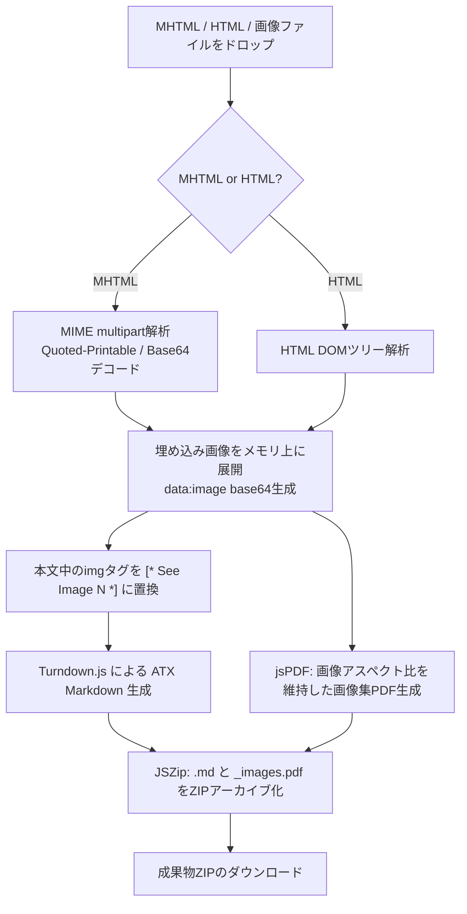

# 1. 🎯 アプリケーションの概要と設計思想

## Web保存ドキュメントのAI活用における「画像の壁」
Webページをブラウザから「Webページ、1つのファイル（.mhtml / .mht）」として保存したアーカイブデータやHTML文書は、技術調査、競合分析、社内ナレッジの蓄積において頻繁に利用されます。しかし、これらをLLM（ChatGPT、Claude、NotebookLM等）で活用しようとすると、以下の致命的な問題が発生します：

1. **埋め込み画像の消失・リンク切れ**:
   通常のHTML to Markdown変換ツールを使うと、`` などの内部リソース参照が破綻し、図表・スクリーンショット・アーキテクチャ図がすべて失われる。
2. **multipart/related 形式の複雑さ**:
   MHTMLはメールと同様のMIMEマルチパート構造（Quoted-PrintableやBase64でエンコードされた画像群）を持っており、一般的なテキストエディタやパーサーでは中身を直接解読できない。
3. **LLMと画像の照合困難**:
   テキストだけをMarkdownに変換しても、「本文中のどこにどの画像が配置されていたのか」という文脈情報が欠落する。

**HTML to MD & Asset Packager** は、これらの課題をブラウザ上で完全自動解決します。MHTMLの内部構造を解析して全画像を抽出・デコードし、本文内の画像位置に `[* See Image 1 *]` のような一意の参照アンカーを自動挿入した上で、**構造化Markdown** と **全画像を実寸で収録した画像集PDF** を内包する **ZIPパッケージ** をワンクリックでビルドします。

---

# 2. ✨ 主な機能と処理フロー



| 機能モジュール | 内部技術 / ライブラリ | 処理内容と出力 |
| :--- | :--- | :--- |
| **MHTML マルチパート・アンパッカー** | 独自MIME境界パーサー | `boundary` 走査、ヘッダー抽出（`Content-Type`, `Content-Transfer-Encoding`, `Content-Location`）、Quoted-Printable/Base64デコード |
| **画像アンカー自動挿入** | DOM Manipulation | `` や `<image>` タグを走査し、本文の該当位置に `[* See Image {id} *]` プレースホルダーを置換挿入 |
| **Markdown コンパイラ** | Turndown.js (atx heading) | クリーンなGitHub Flavored Markdownへの変換、余分な空行（`\n{3,}`）の除去と正規化 |
| **画像集 PDF ビルダー** | jsPDF | 各画像の幅・高さを動的取得し、アスペクト比を維持したまま1画像1ページのPDF（`*_images.pdf`）を生成 |
| **ZIP パッケージャー** | JSZip | `[元ファイル名].md` と `[元ファイル名]_images.pdf` をまとめ、`[元ファイル名]_bundle.zip` として出力 |
| **リアルタイム実行ログ** | React Terminal Ref | 解析・抽出・変換・ビルドの全行程をコンソール形式でリアルタイム通知 |

---

# 3. 🚀 操作手順 (Usage Guide)

### ステップ 1: Webページの保存
1. ChromeやEdge、Safari等のブラウザで、保存したいWebページを開きます。
2. ブラウザのメニューから「名前を付けて保存」を選び、ファイル形式に **「Webページ、1つのファイル (*.mhtml または *.mht)」**（または「Webページ、完全」）を選択して保存します。

### ステップ 2: ドロップゾーンへの投入
1. **HTML to MD Converter** の画面を開きます。
2. 画面左側の巨大なドロップゾーンに、保存した `.mhtml`（または `.html` と画像フォルダ）をドラッグ＆ドロップします（枠内クリックでのファイル選択も可能）。
3. ドロップした瞬間から自動解析が開始され、右ペインの **Conversion Log** に処理進捗が表示されます。

```
ANALYSIS: Preparing file "Kubernetes_Architecture.mhtml"...
MHTML: Unpacking resources...
MHTML: 14 internal images found.
EXTRACTION: Parsing image nodes...
EXTRACTION: 14 image(s) processed.
CONVERSION: Generating Markdown...
PDF: Building image volume with bookmarks...
ARCHIVE: Creating ZIP package...
COMPLETED: Assets ready for download.
```

### ステップ 3: ZIPパッケージのダウンロード
1. 処理が完了すると、ドロップゾーンが「**Conversion Finished**」に切り替わり、緑色のチェックマークと **[Download ZIP]** ボタンが現れます。
2. ボタンをクリックすると、`[ドキュメント名]_bundle.zip` がダウンロードされます。
3. ZIPを展開すると、以下の2つのファイルが生成されています：
   - `[ドキュメント名].md`: 画像アンカー付きのクリーンなMarkdown
   - `[ドキュメント名]_images.pdf`: 本文中のアンカー番号（Image 1, Image 2...）に対応した高解像度画像集PDF

---

# 4. 💡 NotebookLM / マルチモーダルAI連携テクニック

本ツールで出力された成果物は、NotebookLMやClaude 3.5 Sonnet、GPT-4oなどのマルチモーダルAIと組み合わせることで真価を発揮します：

### NotebookLM への同時投入
1. NotebookLM の同一ノートブックに、生成された `.md` と `_images.pdf` の両方をソースとして追加します。
2. プロンプト例：
   ```
   本文中の [* See Image 3 *] で参照されている図表について、_images.pdf の3ページ目を参照しながら、
   システム構成のデータフローを解説してください。
   ```
3. AIはテキストと高解像度図表の両方を正確に照合し、図表内の文字や矢印の関係まで踏み込んだ精緻な回答を生成できます。

---

# 5. ⚠️ 注意事項と制限事項

- **完全クライアントサイド実行**:
  数十MBの大容量Webアーカイブであっても、社外ネットワークへデータがアップロードされることは一切ありません。
- **外部ホスト画像（リンク切れ画像）の扱い**:
  MHTML内に埋め込まれておらず、外部サーバーのURLを直接指している画像で、かつアクセス制限等で取得できないものはアンカー化がスキップされる場合があります。
