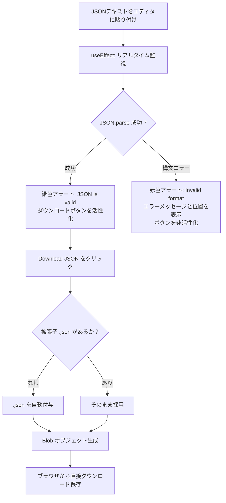

# 1. 🎯 アプリケーションの概要と設計思想

## 開発現場やデータ連携における「JSON保存の煩わしさ」
REST APIのレスポンス検証、データベースのクエリ結果、LLM（ChatGPTやClaude）が生成したJSON出力などをローカルPCにファイルとして保存したい場面は頻繁に発生します。しかし、従来の作業フローには多くの非効率とリスクが存在していました：

1. **テキストエディタを立ち上げる手間の多さ**:
   VS Code等のエディタを開き、新規ファイルを作成し、貼り付け、名前を付けて保存ダイアログを操作するという一連の作業が煩雑。
2. **潜在的な構文エラー（Syntax Error）の未検知**:
   カンマの付け忘れや末尾カンマ（Trailing Comma）、括弧の不一致があるまま保存してしまい、後続のプログラムやバッチ処理で実行時エラーが発生する。
3. **オンラインJSONフォーマッターの機密漏洩リスク**:
   Web上の無料フォーマッターやバリデーターにAPIキーや個人情報を含むJSONを貼り付けると、第三者のサーバーへデータが送信されてしまう。

**JSON Downloader** は、ブラウザ内部でミリ秒単位の **リアルタイム構文検証（Validation）** を行いながら、指定したファイル名でワンクリックでローカルに `.json` ファイルを生成・ダウンロードできる軽量・高速・セキュアなユーティリティです。

---

# 2. ✨ 主な機能とシステム仕様

| 機能 | 仕様 | 実務上のメリット |
| :--- | :--- | :--- |
| **リアルタイム構文検証** | `JSON.parse` の例外トラップ | 1文字入力するたびに構文エラー（Unexpected token等）を瞬時に検知 |
| **エラーメッセージ表示** | パース失敗時のエラー詳細を表示 | どの構文が不正かを即座に把握し、エディタ上で直接修正可能 |
| **ファイル名自動補完** | `.json` サフィックスの自動判定 | `output` と入力しても自動的に `output.json` としてダウンロード |
| **誤保存防止ガード** | 不正なJSON時のダウンロードボタン無効化 | 壊れたJSONファイルがローカルに保存される事故を100%防止 |
| **完全ローカル実行** | メモリ上での `URL.createObjectURL` 生成 | 機密設定ファイルや本番APIレスポンスも安全に処理可能 |

---

# 3. 🚀 操作手順 (Usage Guide)

### ステップ 1: JSONテキストの貼り付け
1. **JSON Downloader** 画面を開きます。
2. 右側のメインテキストエリアに、APIレスポンスやLLMの生成したJSON文字列を貼り付けます。

### ステップ 2: バリデーション結果の確認
1. 左サイドバーの **Validation** ボックスを確認します：
   - **正常な場合**: 緑色の枠で `✔ JSON is valid` と表示されます。
   - **構文エラーがある場合**: 赤色の枠で `✖ Invalid format` とエラーの理由（例: `Expected property name or '}' in JSON at position 42`）が表示されます。
2. エラーが出た場合は、テキストエリア内で赤字メッセージを手がかりに修正します。

### ステップ 3: ファイル名の指定とダウンロード
1. 左サイドバーの **Output Name** に任意のファイル名（例: `user_master`, `api_response.json`）を入力します。
2. **[Download JSON]** ボタンをクリックすると、即座にダウンロードが完了します。
