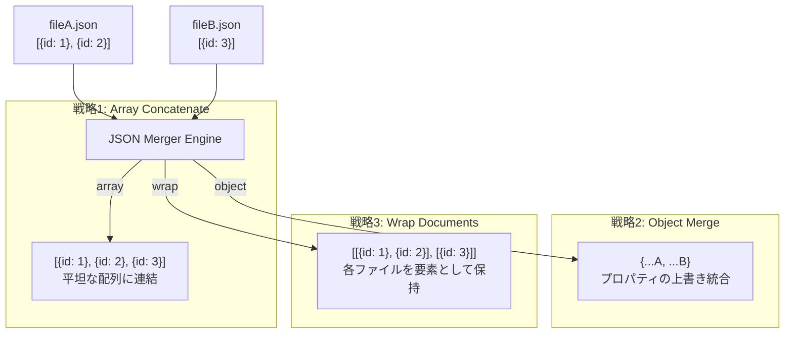

# 1. 🎯 アプリケーションの概要と設計思想

## 分散したデータファイルを1つに束ねる際の課題
ログデータ、テスト用フィクスチャ、分割エクスポートされたマスターデータ、マイクロサービスのレスポンスなど、現場では複数のJSONファイルを1つのファイルに結合（マージ）したいシチュエーションが多発します。

しかし、PythonやNode.jsでマージ用スクリプトを書くのは手間がかかり、単にテキストとして繋ぎ合わせると `}{` や `][` のようにJSON構文が破壊されてしまいます。また、**「どのように結合したいか」** はユースケースによって異なります：

- リスト型データを1つの巨大な配列に平坦化したい（Array Concatenation）
- 複数の設定オブジェクトを後勝ちで上書き統合したい（Object Shallow Merge）
- 各ファイルの独立した構造を維持したまま親配列で囲みたい（Array of Documents）

**JSON Merger** は、GUI上で複数ファイルを直感的に並び替えながら、目的に応じた **3つのマージ戦略** をリアルタイムに切り替えてプレビュー・出力できる専用統合ツールです。

---

# 2. ✨ 3大マージ戦略の仕様と使い分け

| マージ戦略 | 内部ロジック | 典型的なユースケース |
| :--- | :--- | :--- |
| **Array (連結)** | 各ファイルのルートが配列の場合、スプレッド展開（`result.push(...file.content)`）して1つの連続した配列にフラット結合 | 日次アクセスログの月次結合、分割された顧客マスターリストの統合 |
| **Object (上書き)** | オブジェクトのスプレッド結合（`{ ...result, ...file.content }`）。同一キーが存在する場合は後から読み込まれたファイルが優先 | 環境別設定（default.json ➔ production.json）の合成、マスタ辞書の拡張 |
| **Wrap (ラップ)** | 各ファイルの完全なJSON構造を破壊せず、1つの親配列の各要素として格納（`filesData.map(f => f.content)`） | 異なるスキーマを持つ複数帳票の一括バッチ送信、多言語辞書セットの同梱 |

---

# 3. 🚀 操作手順 (Usage Guide)

### ステップ 1: 複数ファイルの投入
1. **JSON Merger** 画面を開きます。
2. 左ペイン上部のドロップゾーンに、結合したい複数の `.json` ファイルを一度にドラッグ＆ドロップします（またはファイル選択）。
3. 登録されたファイルがリスト形式で一覧表示されます。

### ステップ 2: 結合順序の調整（並び替え）
結合の順序（特に Object 戦略の上書き優先度や、Array 戦略の並び順）は重要です：
- **ドラッグ＆ドロップ**: リストアイテムを掴んで上下に直接並び替えることができます。
- **Up / Down ボタン**: 各アイテムの矢印ボタンで1段ずつ移動。
- **A-Z / Z-A ソート**: 上部のソートボタンでファイル名昇順・降順にワンクリック整列。

### ステップ 3: マージ戦略の選択
画面上部のボタングループから、用途に合った戦略（`Array` / `Object` / `Wrap`）を選択します。
選択と同時に、右ペインの **Merged JSON Preview** が瞬時に再計算されます。

### ステップ 4: コピーまたはダウンロード
- **[Copy]**: クリップボードに整形済みJSON（インデント2スペース）をコピー。
- **[Download]**: `merged.json` としてローカルPCに保存。
