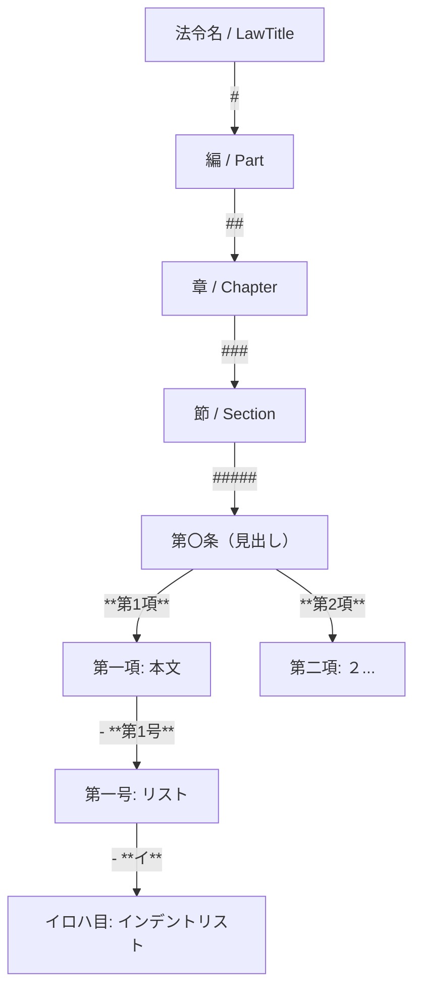
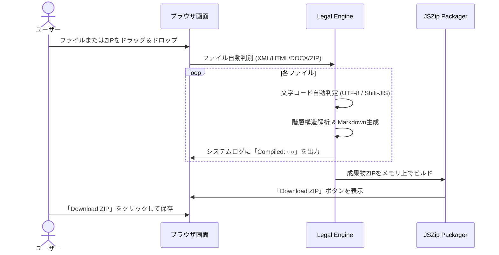

# 1. 🎯 アプリケーションの概要と設計思想

## 開発の背景と目的
日本の法令・規程・条例データは、公的ポータル（e-Gov法令検索）や各自治体の例規集データベース、あるいは庁内Word文書（DOCX）など、多種多様なフォーマットで分散管理されています。これらをChatGPT、Claude、Gemini、NotebookLM等の最新LLM（大規模言語モデル）やRAG（検索拡張生成）システムに読み込ませる際、以下の大きな技術的障壁が存在していました：

1. **法令特有の複雑な階層性**:
   「編」「章」「節」「款」「目」「条」「項」「号」「イロハ」といった多層的なインデント構造が崩れ、AIが条文間の包含関係や上位概念を誤認する。
2. **第一項の数字省略ルール**:
   日本の法令は「第二項」以降には「２」などの数字が振られますが、「第一項」は条文の直後に数字なしで記述されるという特殊規則があり、素朴なテキスト抽出では第一項が条文見出しと混同される。
3. **表形式（別表・別記様式）の欠落**:
   e-Gov XMLの表構造タグ（`TableStruct`, `TableRow`, `TableColumn`）がプレーンテキスト化により破壊され、重要な数値基準や分類表が消失する。
4. **大量ファイルの一括処理コスト**:
   1つの自治体で数百本におよぶ例規集を1本ずつ手作業でコピー＆ペーストすることは非現実的。

**Legal Compiler for AI** は、これらの課題を抜本的に解決するため、ブラウザ完結型（WebAssembly / JavaScript）で動作し、ドラッグ＆ドロップによる複数ファイルおよびZIPアーカイブの一括バッチコンパイルを実現する専用コンパイラです。

---

# 2. ✨ 主な機能とアーキテクチャ

| モジュール | 対応ソース形式 | 変換処理内容 | 主な出力仕様 |
| :--- | :--- | :--- | :--- |
| **e-Gov XML コンパイラ** | `.xml` (e-Gov 標準法令形式 v5) | DOMパーサーによる完全階層走査、別表・表構造マトリクス展開、元号日付の正規化 | ATX見出し（`#`〜`#####`）、太字項・リスト号、YAMLメタデータ |
| **例規集 HTML コンパイラ** | `.html`, `.htm` (自治体例規・Reiki-Base) | `.eline` / `.joubun` クラス解析、条文先行/見出し先行パターンの正規表現抽出 | 構造化Markdown、漢数字の算用数字正規化、改正履歴注記 |
| **DOCX コンパイラ** | `.docx` (庁内起案・Word規程文書) | `mammoth.js` によるHTML中間変換 ➔ 例規パースパイプライン適用 | 構造化Markdown、段落リストの再構成 |
| **ZIP アーカイブ展開** | `.zip` (自治体例規一括エクスポート) | `JSZip` によるアーカイブ走査（`__MACOSX` 自動除外）、複数法令の自動分別・一括ビルド | `Legal_Artifacts_YYYY-MM-DD.zip` に全MDを一括パッケージ化 |

> [!NOTE]
> **ゼロ・データ送信アーキテクチャ**:
> 本ツールはアップロードされた法令・規程ファイルを外部サーバーへ一切送信しません。すべてのパース・変換処理はお使いのブラウザ内部（メモリ上）で完結するため、未公開の要綱案や庁内内部規程も安全に処理できます。

---

# 3. 🧠 コアアルゴリズムと変換仕様

## 3.1 階層構造とMarkdownマッピング

法令の論理階層を、Markdownの見出しおよびリスト記号に以下のようにマッピングします：



- **第一項の自動補正**:
  条文見出し（`ArticleCaption` + `ArticleTitle`）の直後に続く文に対し、項番号タグが存在しない場合でも自動的に `**第1項**` を補完して出力します。
- **漢数字・全角数字の統一**:
  「第百二十三条」「第１２３条」などの揺らぎを内部で算用数字 `第123条` に正規化し、LLMが検索キーとして統一的にインデックスできるようにします。

## 3.2 テーブル構造 (`TableStruct`) のマトリクス展開

e-Gov XMLにおける複雑な表組みは、行内のセルごとに異なる改行数（複数Sentence）を持つ場合があります。本コンパイラは各列の最大行数を動的に計算し、空セルを適切に前値補完しながら、標準GitHub Flavored Markdownテーブルとして再構成します。

## 3.3 LLM向け YAML フロントマターの自動生成

変換された各Markdownファイルの先頭には、AIが文書の全体構造とメタデータを瞬時に把握できるよう、以下のYAMLフロントマターが自動挿入されます：

```yaml
---
title: "行政手続における特定の個人を識別するための番号の利用等に関する法律"
law_num: "平成二十五年法律第二十七号"
enact_date: "平成25年5月31日公布"
source_type: "xml_converted"
structure_summary:
  parts: 0
  chapters: 6
  sections: 4
  articles: 52
  paragraphs: 148
  items: 89
---
```

---

# 4. 🚀 操作手順 (Usage Guide)



### ステップ 1: ソースファイルの準備
以下のいずれかの形式のファイルを準備します（複数ファイルの混在や、それらをまとめたZIPファイルも可）：
- e-Govからダウンロードした法令XMLファイル（`.xml`）
- 自治体例規集から保存したHTMLファイル（`.html`, `.htm`）
- Microsoft Wordで作成された要綱・規程文書（`.docx`）
- 上記をまとめたZIPアーカイブ（`.zip`）

### ステップ 2: ドロップゾーンへの投入
1. 画面中央の点線枠（**Drop Source Code**）に対象ファイルをドラッグ＆ドロップします（または枠内をクリックしてファイル選択）。
2. ドロップすると即座にコンパイルが開始され、中央のバイナリアイコンが回転しながら処理ログが下部の**System Log**ターミナルに逐次出力されます。

### ステップ 3: 成果物ZIPのダウンロード
1. コンパイルが完了すると「**Compilation Complete**」画面に切り替わります。
2. **[Download ZIP]** ボタンをクリックすると、`Legal_Artifacts_YYYY-MM-DD.zip` がダウンロードされます。
3. アーカイブ内には、元の法令名に基づいて命名された `.md` ファイル群が格納されています。

---

# 5. 💡 LLM / NotebookLM 活用ベストプラクティス

コンパイルされたMarkdownファイルは、AIのナレッジソースとして最大の性能を発揮するよう最適化されています。

### 活用法 1: NotebookLM のソースとして投入
- 生成された `.md` ファイルをそのまま NotebookLM にアップロードします。
- 条・項・号が太字および箇条書きで構造化されているため、「第○条第○項の除外規定は何ですか？」といったピンポイントな質問に対して、ハルシネーション（幻覚）なく正確な参照引用が可能になります。

### 活用法 2: ChatGPT / Claude のプロンプト指示
プロンプトのコンテキストとして条文を貼り付ける際、YAMLフロントマターをそのまま含めることで、LLMは法令の公布日や総条数を即座に理解し、正確な解釈を展開します。

```markdown
以下の法令定義（YAMLおよびMarkdown）に基づき、第12条各号の要件に該当するか判定してください：

[コンパイルされたMarkdown内容を貼り付け]
```

---

# 6. ⚠️ トラブルシューティング

| 現象 | 主な原因 | 対処方法 |
| :--- | :--- | :--- |
| **文字化けが発生する** | 旧来の自治体HTMLがShift-JISまたはEUC-JPでエンコードされている | 本ツールはUTF-8およびShift-JISの自動判別を内蔵していますが、特殊なエンコードの場合はテキストエディタ等でUTF-8に再保存して投入してください。 |
| **ZIP内のファイルが処理されない** | Macで作成されたZIPの隠しファイル（`__MACOSX`）など | コンパイラ内部で `__MACOSX` は自動除外されます。拡張子が `.xml`, `.html`, `.docx` であることを確認してください。 |
| **表のレイアウトが崩れる** | 結合セル（`rowspan`/`colspan`）が極端に多い複雑な別表 | 複雑な結合表はMarkdownの仕様上完全再現が難しいため、表構造マトリクスの空セル自動補完機能によりデータが保持されているか確認してください。 |
