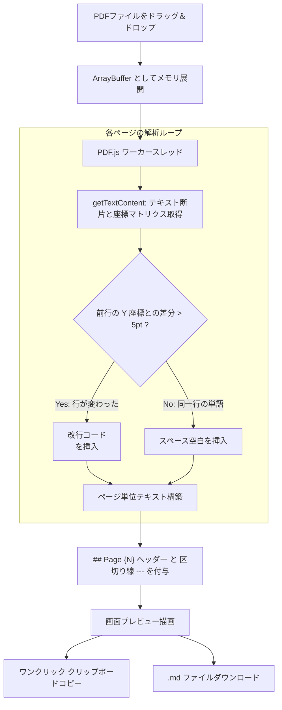

# 1. 🎯 アプリケーションの概要と設計思想

## 機密PDFのAI利活用におけるセキュリティ課題
報告書、論文、仕様書、決裁文書、契約書など、ビジネスや公務で流通する重要文書の多くはPDF形式で保存されています。これらをChatGPTやClaude等のAIツールで要約・分析したい場合、以下の課題が立ちはだかります：

1. **セキュリティ・機密情報漏洩リスク**:
   無料のオンラインPDF変換サービスを利用すると、文書データが運営会社の海外サーバーに送信・一時保存されるリスクがあり、社外秘・個人情報を含む文書には利用できない。
2. **ページ構造と見出しの崩壊**:
   PDFからコピー＆ペーストすると、改行が不自然に入り組んだり、ページ区切りが消滅して「どの記述が何ページ目にあったのか」が追跡不能になる。
3. **OCRや不要なバイナリノイズ**:
   余分な文字化けやレイアウト崩れが発生し、LLMに投入した際のトークン消費が無駄に増大する。

**PDF to Markdown Converter** は、Mozillaが開発する業界標準のPDFレンダリングエンジン **PDF.js (`pdfjs-dist`)** をブラウザ上で直接駆動させ、**サーバー通信一切なし（Zero Network Transmission）** でPDF内部のテキストと位置座標を高速解析し、ページ単位の階層化Markdownに変換するセキュアツールです。

---

# 2. ✨ 主な機能と座標ベース抽出アルゴリズム



| 機能 | 内部仕様 / アルゴリズム | 実務上のメリット |
| :--- | :--- | :--- |
| **完全ローカル処理** | Web Worker / WebAssembly (`pdfjs-dist`) | インターネット接続不要。機密PDFや庁内内部文書も安心 |
| **Y座標ベースの行判定** | `item.transform[5]` 座標差分検出（`|ΔY| > 5`） | PDF特有の「同一行の単語分断」を防ぎ、自然な段落・行送りを復元 |
| **ページ境界の明確化** | `## Page {pageNum}` および `---` 挿入 | RAGやLLMへの質問時に「○ページ目に〜と記載」と正確に引用可能 |
| **即時クリップボードコピー** | `navigator.clipboard.writeText` | ワンクリックでChatGPT等のプロンプト欄に直接貼り付け可能 |
| **Markdown保存** | Blob URL による `.md` 書き出し | ローカルナレッジベースやObsidian等への蓄積が容易 |

---

# 3. 🚀 操作手順 (Usage Guide)

### ステップ 1: PDFファイルの投入
1. **PDF to Markdown** 画面を開きます。
2. 画面上部のドロップゾーンに、変換したいPDFファイルをドラッグ＆ドロップします（またはエリアをクリックしてファイル選択）。
3. 投入と同時に解析が自動的に開始されます。

### ステップ 2: プレビューの確認
1. 解析が完了すると、画面下部のエディタエリアに変換後のMarkdownが即座に表示されます。
2. 各ページが `## Page 1`, `## Page 2` ... と区切られていることを確認します。

### ステップ 3: コピーまたはファイル保存
- **プロンプトにすぐ使いたい場合**:
  ヘッダー右上の **[コピー]**（コピーアイコン）をクリックすると、全文がクリップボードに格納されます。
- **ファイルとして保存したい場合**:
  ヘッダー右上の **[ダウンロード]**（ダウンロードアイコン）をクリックすると、`[PDFファイル名].md` がPCに保存されます。

---

# 4. 💡 LLM プロンプト活用例

ページ番号が保持されたMarkdownは、LLMでの精密な文書精読に最適です：

```markdown
以下のドキュメントは業務マニュアルのPDFから抽出したMarkdownです。
各ページ（## Page N）の記述に基づき、以下の点に答えてください：

1. システム障害発生時の一次対応手順は何ページのどの項目に記載されていますか？
2. 報告書の提出期限と提出先を明記してください。

[抽出されたMarkdownを貼り付け]
```

---

# 5. ⚠️ 注意事項と対応範囲

> [!NOTE]
> **テキスト埋め込みPDFとスキャン画像PDFの違い**:
> 本ツールはWordやPowerPoint等から「PDFとして保存」されたテキスト埋め込み型PDFに対応しています。紙の文書をスキャナで読み取った「純粋な画像PDF」の場合は、あらかじめOCR（文字認識）処理が施されたPDFをご利用ください。
