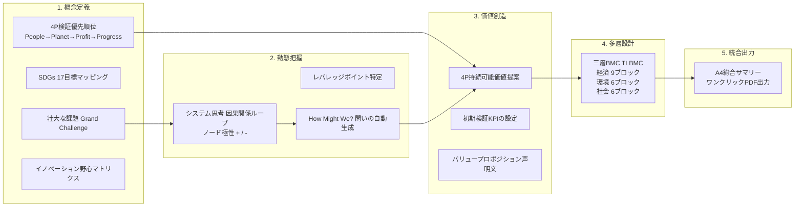

# 1. 🎯 アプリケーションの概要と設計思想

## 21世紀のビジネスモデル転換：従来型BMCからの脱却
アレックス・オスターワルダーらによって提唱された従来の「ビジネスモデル・キャンバス（BMC）」は、企業の経済的価値と利益創出メカニズムを可視化する優れたツールでした。しかし、気候変動、資源枯渇、格差拡大といった地球規模の課題が深刻化する現代において、「株主利益の最大化」のみを追求するモデルは、重大な外部不経済（環境破壊・過酷労働）を見落とすリスクを孕んでいます。

**サステナブル経営戦略 総合評価シート**（Sustainable Strategy Evaluator）は、英国 **The Open University** および **Explorer Labs** の持続可能ビジネスモデル実践体系、ならびに Joyce & Paquin (2016) の **三層構造ビジネスモデル・キャンバス（Triple-Layered Business Model Canvas: TLBMC）** に完全準拠した戦略立案・評価支援ツールです。

「利益（Profit）」を目的ではなく「持続のための手段」と位置づけ、**人（People: 社会的望ましさ）** と **地球（Planet: 生態系の必要性）** を起点とする循環型ビジネスモデルの設計を体系的にナビゲートします。

---

# 2. ✨ 全体フレームワーク体系と5つのコア領域

| タブ / 領域 | 対象フレームワーク | 主な機能と分析項目 |
| :--- | :--- | :--- |
| **1. 概要・4P優先・野心** | コンセプト定義 & 4P検証優先原則 | ・直面する壮大な課題（Grand Challenge）とソリューション骨子 ・17のSDGs目標（アイコン選択式）マッピング ・**4P検証順序（People → Planet → Profit → Progress）** の遵守確認 ・イノベーション野心マトリックス（既存/新市場 × 既存/新技術） |
| **2. システム思考・HMW** | 因果ループ & レバレッジポイント | ・システム変数（ノード）と相互影響の極性（`[+]` 強化 / `[-]` 抑制） ・介入点（レバレッジポイント）の特定 ・**How Might We?（どうすれば〜できるか？）問い文の自動生成** |
| **3. 価値提案キャンバス** | 4P持続可能価値提案 & 初期検証KPI | ・4P各側面（人・地球・利益・進歩）における独自の提供価値明文化 ・初期実証段階（PoC）で計測すべき定量的KPIの設定 ・統合バリュー・プロポジション・ステートメントの自動合成 |
| **4. 三層BMC (TLBMC)** | Triple-Layered Business Model Canvas | ・**経済レイヤー（9ブロック）**: パートナー、活動、リソース、価値提案、顧客関係、チャネル、顧客セグメント、コスト、収益 ・**環境レイヤー（6ブロック）**: 供給、生産、機能的価値、使用、寿命末期（廃棄/回収）、環境便益・環境負荷 ・**社会レイヤー（6ブロック）**: 地域社会、従業員、ガバナンス、社会的価値、社会的便益・社会的負荷 |
| **5. 総合評価・A4出力** | レポーティング & PDF出力 | ・全フレームワークの入力内容をA4規格の経営レポート形式に統合整形 ・ブラウザ印刷（Cmd+P / Ctrl+P）によるワンクリックPDF出力 |

---

# 3. 🧠 コア理論と設計アプローチのポイント

## 3.1 4P検証優先順位の原則
従来型事業開発では「Profit（儲かるか？）」から着手しがちですが、本フレームワークでは以下の順序で仮説検証を行います：

1. **People（社会的望ましさ）**: 困っている人は実在するか？生活の質は向上するか？
2. **Planet（生態学的必要性）**: 地球環境に負荷を与えず、むしろ再生（リジェネラティブ）に貢献するか？
3. **Profit（経済的実行可能性）**: 継続的に事業を維持・拡大するための健全な利益は確保できるか？
4. **Progress（技術的・制度的実現可能性）**: 現代の技術や法制度で実際に運用可能か？

## 3.2 システム思考とレバレッジポイントの探索
問題の「症状（モグラ叩き）」に対処するのではなく、因果関係のループ（強化ループ・平衡ループ）を紐解きます。
例えば、「資材廃棄量の増加」➔「処分コストの増大」➔「価格転嫁による顧客離れ」という悪循環に対し、どこに介入（レバレッジ）すれば好循環へ反転できるかを分析します。

## 3.3 三層BMC (TLBMC: Joyce & Paquin 2016) の統合整合性
経済層の「リソース」が環境層の「供給・素材」とどうリンクし、社会層の「従業員・地域」にどう還元されるかを縦串（Vertical Alignment）で整合させます。

---

# 4. 🚀 操作手順 (Usage Guide)

### ステップ 1: 実務サンプルの読み込み
1. 画面右上の **[サンプル読込]** をクリックします。
2. 講義・実践で用いられる「循環型リユース資材プラットフォーム（LoopPack）」の完成データが全タブに展開されます。
3. 自社の新規事業を検討する場合は **[新規]** を押して白紙から開始します。

### ステップ 2: 概要とイノベーション野心の入力
1. **[1. 概要・4P優先・野心]** タブで、対象となるSDGs目標アイコンをクリックして選択します。
2. 事業が位置する野心ゾーン（中核の改善・隣接市場への進出・破壊的変革）を指定します。

### ステップ 3: システム思考とHMWの導出
1. **[2. システム思考・HMW]** タブで、関連する要素と影響関係（`[+]` または `[-]`）を整理します。
2. レバレッジポイントを入力すると、右側に「How Might We（どうすれば私たちは〜できるだろうか？）」の問いが自動生成されます。

### ステップ 4: 三層BMCの27ブロック入力
1. **[4. 三層BMC]** タブを開き、サブタブ（経済レイヤー / 環境レイヤー / 社会レイヤー）を切り替えながら、各ブロックを埋めていきます。
2. 環境層では「寿命末期（回収・リサイクル）」を、社会層では「社会的便益（地域雇用・健康）」を漏れなく記述します。

### ステップ 5: A4総合サマリーの出力とPDF化
1. **[5. A4総合サマリー]** タブを開きます。
2. 全タブの入力内容がA4縦規格の美しく洗練された報告書形式で自動生成されます。
3. **[A4印刷 / PDF]** ボタンをクリック（または Cmd+P / Ctrl+P）することで、取締役会や公的助成金申請にそのまま提出可能なPDFを出力できます。
