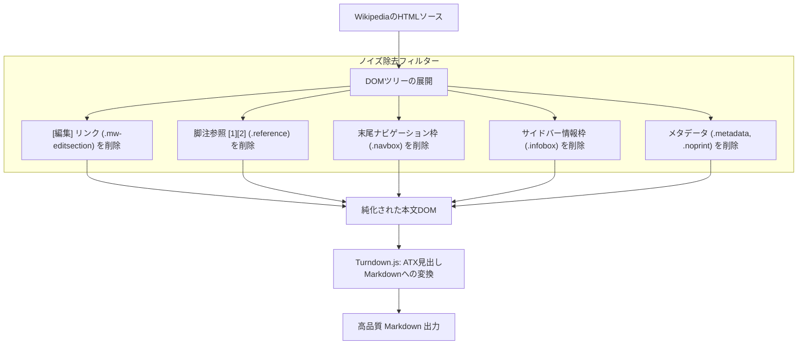

# 1. 🎯 アプリケーションの概要と設計思想

## WikipediaテキストをAIに読み込ませる際の「ノイズ問題」
Wikipediaは世界最大級の知識ベースであり、市場調査、歴史的経緯の確認、技術用語の定義確認など、あらゆる知的生産の基礎資料として頻繁に参照されます。しかし、ブラウザ上でWikipediaのページをコピーしてそのままChatGPTやClaude等のLLMに貼り付けると、以下のような大量の「ゴミ情報（ノイズ）」が混入します：

1. **無数の編集リンク**: `[編集]` や `edit` といったリンクテキストが各見出しに散乱する。
2. **脚注番号のインライン混入**: `[1]`, `[2]`, `[要出典]` といった上付き数字が文中にびっしりと挿入され、AIの文章理解や固有表現抽出を妨げる。
3. **長大なナビゲーション表**: ページ末尾にある関連テンプレート（`navbox`）やサイドバー（`infobox`）が大量のトークンを無駄に消費する。
4. **印刷用非表示タグ**: スクリーンリーダー用や印刷制御用の隠しメタデータが不自然なテキストとして残る。

**Wiki to Markdown Converter** は、WikipediaのHTML構造からこれらのノイズ要素をDOMレベルで正確に剪定（プルーニング）し、純粋な知識本文だけを階層的なATX Markdown（`#`〜`####`）に再構成する専用フィルタリングツールです。

---

# 2. ✨ 自動除去されるノイズ要素一覧



| セレクタ / 要素 | 画面上の表示例 | 除去する理由 |
| :--- | :--- | :--- |
| `.mw-editsection` | `[編集]` | 見出しテキストの汚染を防ぎ、正確な章立て構造を保つため |
| `.reference` | `[1]`, `[23]`, `[注 1]` | 文中の単語分断やAIの誤読を防ぎ、流暢なテキストにするため |
| `.navbox` | ページ最下部の巨大リンク集 | 本論と無関係な大量の関連項目リンクによるトークン浪費を防ぐため |
| `.infobox` | ページ右上の要約テーブル | 複雑な表組の崩れを防ぎ、本文のストーリー展開に集中させるため |
| `.metadata`, `.noprint` | 「この記事には複数の問題があります…」等 | 記事の本質的コンテンツではない運営用メッセージを除去するため |

---

# 3. 🚀 操作手順 (Usage Guide)

### ステップ 1: Wikipedia記事のHTMLを取得
1. ブラウザで変換したいWikipediaのページを開きます。
2. 以下のいずれかの方法でコンテンツをコピーします：
   - **方法 A (簡単)**: 記事のタイトルから本文末尾までをマウスでドラッグ選択し、コピー（Cmd+C / Ctrl+C）。
   - **方法 B (確実)**: ブラウザの「ページのソースを表示」または開発者ツール（F12）で `<div id="bodyContent">` 配下のHTMLをコピー。

### ステップ 2: エディタへの貼り付けと変換
1. **Wiki to Markdown** 画面を開きます。
2. 左ペインの **Input Textarea** にコピーした内容を貼り付けます。
3. 中央の **[CONVERT]** ボタンをクリックします。

### ステップ 3: 純化されたMarkdownの確認とダウンロード
1. 右ペインの **Markdown Output** に、ノイズが完全に除去された美しいMarkdownが即座に出力されます。
2. 右上の **[Download]** ボタンをクリックすると、`wiki_content.md` として保存できます。

---

# 4. 💡 活用事例：NotebookLM のナレッジソース化

Wikipediaから抽出したクリーンなMarkdownを NotebookLM や Obsidian に投入することで、高品質なパーソナルナレッジベースを構築できます：

```markdown
# 人工知能の歴史

## 第一次ブーム（推論と探索）
1950年代から1960年代にかけて、コンピュータによる定理証明やチェス・チェッカーなどのゲームプレイが研究された。
（※「[1][2][編集]」などのゴミ情報が一切ないため、AIの要約品質が劇的に向上）
```
