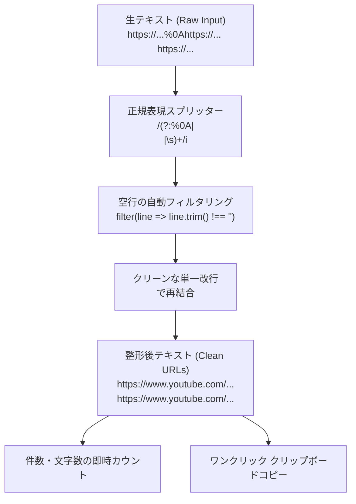

# 1. 🎯 アプリケーションの概要と設計思想

## NotebookLM で YouTube 動画を研究・学習する際の課題
Google の **NotebookLM** は、YouTube 動画のURLを入力するだけで、自動生成された字幕や音声を解析し、要約・Q&A・ポッドキャスト化を行える革新的なリサーチツールです。

しかし、講義動画シリーズ、技術カンファレンスのプレイリスト、競合製品のレビュー動画などを一括して NotebookLM に読み込ませたい場合、以下のフォーマット上の問題に直面します：

1. **拡張機能やブックマークレットが吐き出す `%0A` エンコード**:
   ブラウザ拡張やスクレイピングツールで抽出したURLリストは、改行が URL エンコードされた `%0A` やスペース、タブで連結されていることが多く、そのまま貼り付けるとNotebookLMが「無効なURL」としてエラーを起こす。
2. **空行や重複スペースの混入**:
   コピー元のWebサイトの都合で無駄な空白行やスペースが混ざり、手作業で1行ずつBackSpaceキーを押して整形する無駄な作業が発生する。
3. **URL件数の把握困難**:
   「いま何本の動画を投入しようとしているのか」が視覚的に分からず、NotebookLMのソース上限（最大50ソース）に達しているかどうかの確認が面倒。

**YouTube URL Formatter** は、貼り付けられた乱雑なURL群から `%0A`、空白、不正な改行を瞬時に分離・除去し、**NotebookLMが要求する「1行1URL」のクリーンな改行区切りリスト** にワンクリックで再編成する専用フォーマッターです。

---

# 2. ✨ 主な機能と正規化ロジック

| 機能 | 仕様 / 内部ロジック | 実務上のメリット |
| :--- | :--- | :--- |
| **`%0A` 自動デコード分解** | 正規表現 `/(?:%0A|\n|\s)+/i` | URLエンコードされた改行記号（`%0A`）を完全に認識して分離 |
| **空白・タブ・混在改行の平坦化** | スペース区切り・連続空行の除去 | どのような形式でコピーされたURL群でも、等間隔の改行リストに正規化 |
| **リアルタイム件数カウンター** | `output.split('\n').filter(Boolean).length` | 整形後の有効URL本数を即座に表示。NotebookLMの上限管理が容易 |
| **ワンクリックコピー** | `navigator.clipboard.writeText` | ワンタップでクリップボードへ保存（コピー完了表示付き） |
| **ワンクリック全クリア** | 入力欄・出力欄の同期クリア | 次の動画リストへの素早い切り替え |

---

# 3. 🚀 操作手順 (Usage Guide)

### ステップ 1: YouTube URL一覧のコピー
ブラウザ拡張機能（例: TabCopy、Link Kホルダ）やブックマークレット、テキストファイル等から、まとめたいYouTubeのURL群をコピーします。

### ステップ 2: 入力とワンクリック整形
1. **YouTube URL Formatter** 画面を開きます。
2. 左側の **入力テキスト (Raw Input)** 欄にコピーした内容を貼り付けます。
3. **[URL整形を実行]** ボタンをクリックします。

### ステップ 3: 件数の確認とコピー
1. 右側の **整形後テキスト (Clean URLs)** 欄に、綺麗に整列されたURL一覧が出力されます。
2. 枠上部に「**○ 件のURL**」と集計結果が表示されます。
3. **[コピー]** ボタンをクリックしてクリップボードに格納します。

### ステップ 4: NotebookLM への一括投入
1. NotebookLM を開き、ソース追加ダイアログで「YouTube」を選択します。
2. クリップボードからそのまま貼り付けることで、エラーなく動画ソースが一括登録されます。
